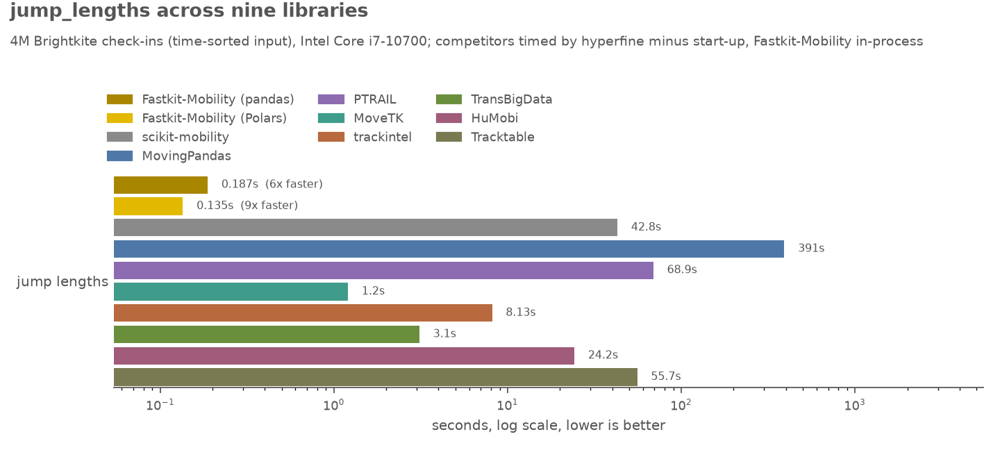
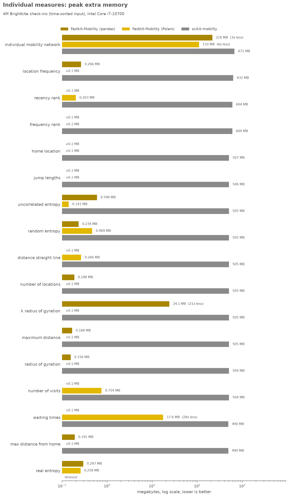
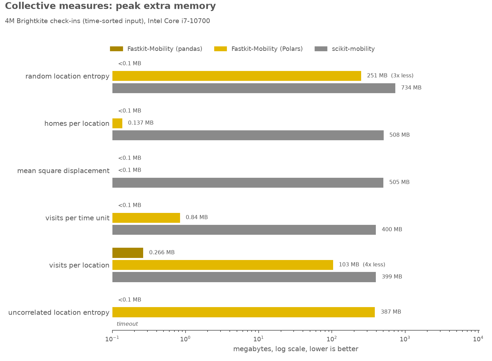
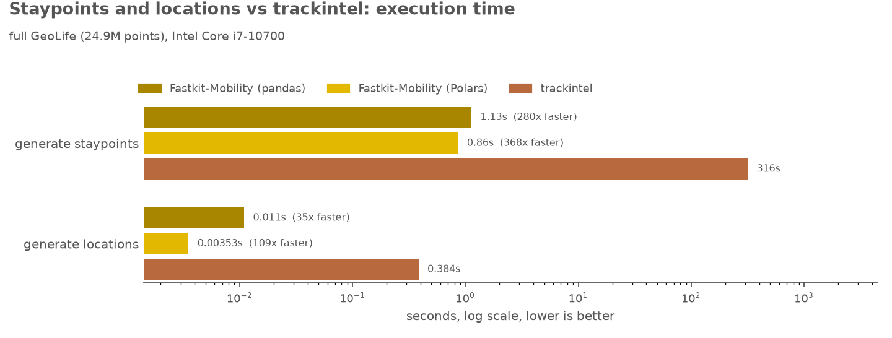
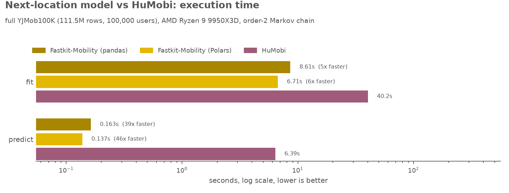
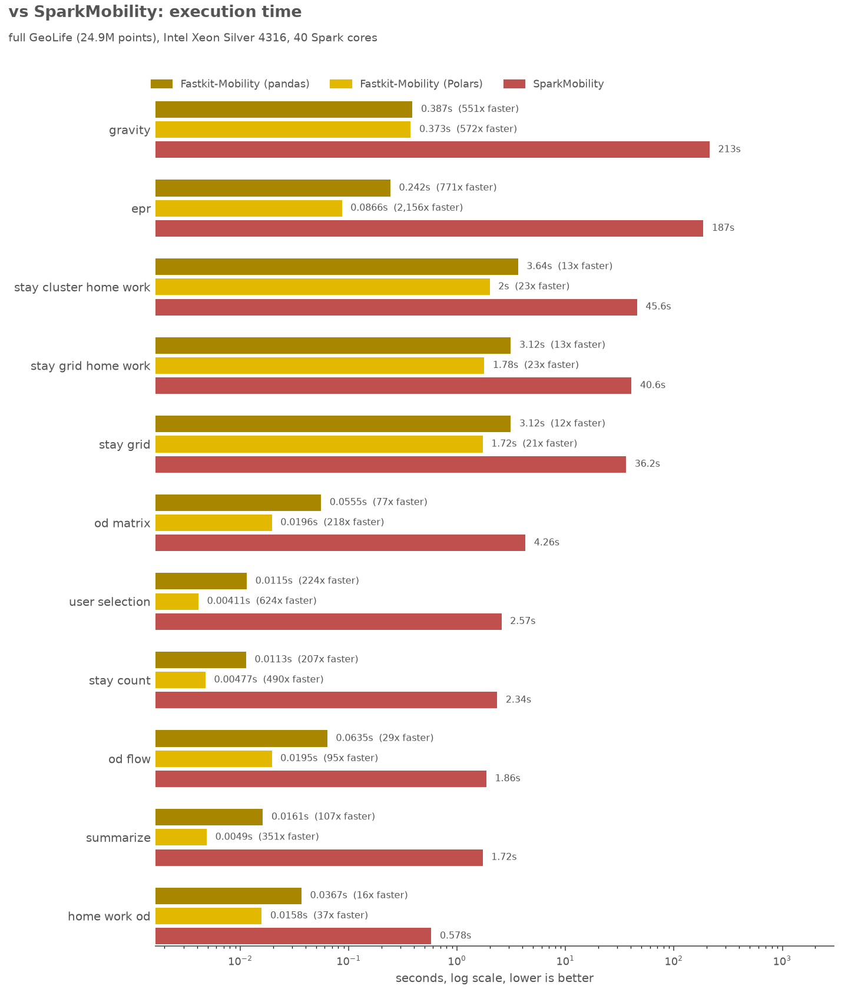
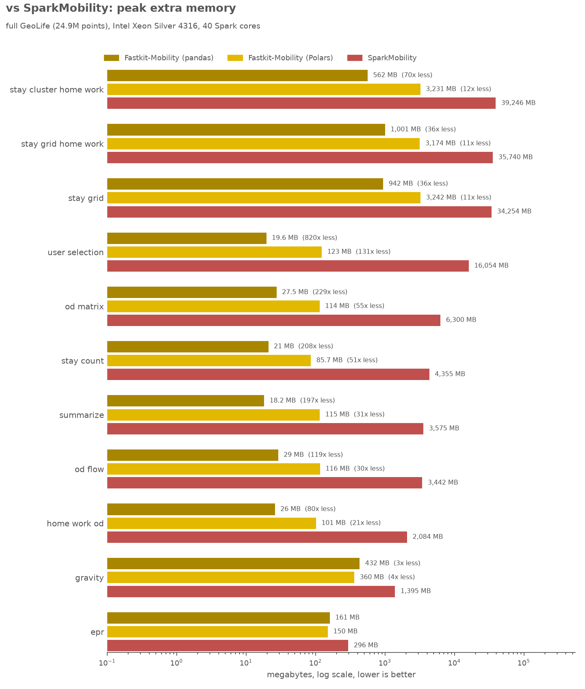

# Benchmark Results

These plots compare Fastkit-Mobility with every library that offers the same function. Bars show average time (or peak extra memory) on a log axis, and the label on a Fastkit-Mobility bar is its advantage over the best other library. A bar reading *timeout* or *error* means the library did not finish; those operations are kept, not hidden.

The numbers are environment-specific, so read them as benchmark evidence for these runs rather than as a universal performance guarantee.

## Summary

| Suite | Compared with | Data | Hardware | Headline result |
|---|---|---|---|---|
| [Individual and collective measures](#measures) | scikit-mobility | 4M Brightkite check-ins | Core i7-10700 | individual measures about 190x to 2,700x faster; two scikit-mobility measures time out; slower than scikit-mobility on `visits_per_location` with pandas (1.28 s against 1.18 s); `visits_per_time_unit` only 2.6x faster |
| [Preprocessing](#preprocessing) | scikit-mobility, MovingPandas, PTRAIL, MoveTK | 4M GeoLife points | Xeon Silver 4316 | see figure; MovingPandas times out on Douglas-Peucker simplification |
| [Staypoints and locations](#staypoints-and-locations) | trackintel | full GeoLife, 24.9M points | Core i7-10700 | staypoints 0.86 s against 316 s |
| [Next-location model](#next-location-model) | HuMobi | YJMob100K, 111.5M rows | Ryzen 9 9950X3D | fit 5-6x and predict 39-46x faster on YJMob100K; on Brightkite the pandas fit is only 1.7x faster |
| [Single function, every library](#one-function-every-library) | eight other libraries | 4M Brightkite check-ins | Core i7-10700 | `jump_lengths`; MoveTK ties at small sizes |
| [Road network](#road-network) | TransBigData, stplanr with OSRM | GeoLife Beijing | Core i7-10700 | much faster distances, routes and CH preparation; slower fetch-and-extract build |
| [Privacy risk](#privacy) | scikit-mobility | toy trajectories repeated 30x | Core i7-10700 | see figure |
| [Distributed baseline](#distributed-baseline-sparkmobility) | SparkMobility | full GeoLife, 24.9M points | Xeon Silver 4316 | see figure |
| [Scaling without a competitor](#scaling-fastkit-mobility-only) | none | YJMob100K up to 111.5M rows | Core i7-10700 | motifs, mobility laws, social recast |

## Setup

| Item | Value |
|---|---|
| Hardware | Intel Core i7-10700 (16 threads) unless stated; Intel Xeon Silver 4316 (40 threads) for preprocessing and SparkMobility; AMD Ryzen 9 9950X3D for the next-location suite. A single figure never mixes machines. Most suites were also run on the Ryzen and the Xeon, and those results are in the raw repository. |
| Python | 3.12 for Fastkit-Mobility (3.13 on the Xeon preprocessing run). Each competitor runs in its own environment: scikit-mobility, for instance, ran on 3.10 in the privacy suite and 3.11 elsewhere. |
| Timing | Average wall-clock time of repeated runs, with data loading excluded. The `jump_lengths` competitors are timed by `hyperfine` with the interpreter start-up and import baseline subtracted. |
| Memory | Peak resident memory above a load-only baseline. A bar labelled `<0.1 MB` means the operation stayed below what the method can resolve, not that it used no memory. |
| Input order | The measures figures use time-sorted input; preprocessing and SparkMobility use raw (unsorted) input. |
| Timeouts | 900 s for measures (3,600 s for `uncorrelated_location_entropy`). Preprocessing used 900 s per case; MovingPandas was rerun with 32,000 s and its Douglas-Peucker simplification still exceeded it. No SparkMobility case timed out. |
| Datasets | Brightkite (about 4M check-ins; scikit-mobility received 3,999,891 rows, Fastkit-Mobility 4,000,000), GeoLife (24.9M points in full) and YJMob100K (111.5M rows in full). |

Memory ratios are shown only when Fastkit-Mobility uses at least 5 MB, because smaller values sit inside the measurement noise. Raw results, scripts and per-library environments are in the [`fastmob_benchmarks`](https://github.com/gefgu/fastmob_benchmarks) repository.

## One function, every library

`jump_lengths` is the function the most libraries share. Competitors are timed by `hyperfine` in a separate process, with the start-up cost subtracted, while Fastkit-Mobility is timed in-process, so treat this plot as a ranking rather than an exact ratio. Differences below about 0.02 s are within measurement noise: MoveTK and Fastkit-Mobility are effectively tied at 1k and 10k rows, and the gap opens with the data size. The scikit-mobility bar here (42.8 s) differs from the measures figure (79.2 s) because the two suites time the work differently.



## Measures

### Individual




### Collective




## Preprocessing

MoveTK appears for operations it implements. Its Douglas-Peucker time (1.97 s) is its total minus its own file-parsing baseline and is not measured on the same boundary as the Fastkit-Mobility bars, so it is not a like-for-like win. MovingPandas timed out on that operation. Fastkit-Mobility times come from the 2026-08 table record (`preprocessing_benchmarks.json`); later per-case checkpoints from an unreleased development build are not used.


## Staypoints and locations

Compared with trackintel on the full GeoLife dataset (single runs). Only stages that produce comparable results are shown. Fastkit-Mobility's tripleg generation does not yet split on tracking gaps (388 triplegs against trackintel's 4,146), so triplegs, trips and tours are left out of the comparison.



## Next-location model

`NextLocationPredictor` compared with HuMobi's Markov chain. These runs were recorded on the Ryzen host and the absolute times may carry some disk contention. Fastkit-Mobility predicts the most frequent next location, while HuMobi draws from the transition frequencies, so the predicted locations are not expected to match one by one.




## Road network

Compared with TransBigData and with stplanr using a local OSRM server, on GeoLife Beijing (Core i7-10700). This is mixed evidence: building a road network by fetching and extracting it is slower in Fastkit-Mobility, but the two are not like for like: Fastkit-Mobility fetches live data from Overture on S3, while stplanr's `osrm-extract` reads a local file. The comparable preparation step (CH preparation) favours Fastkit-Mobility. Values below are seconds from single runs; cells marked n/a mean the library has no matching operation.

| Operation | Scale | Fastkit-Mobility | TransBigData | stplanr (OSRM) |
|---|---|---:|---:|---:|
| Build road network (fetch/extract) | 1 km² | 91.3 | n/a | 4.07 |
| Build road network (fetch/extract) | 25 km² | 136.2 | n/a | 0.36 |
| Build road network (fetch/extract) | 225 km² | 125.8 | n/a | 0.77 |
| Network distances | 10,000 OD pairs | 0.005 | 84.4 | timeout |
| Route geometry | 1,000 queries | 0.03 | 8.44 | 1.36 |
| Route geometry | 10,000 queries | 0.01 | 83.4 | timeout |
| OD desire lines | 1,000 OD pairs | 0.004 | n/a | 2.28 |
| OD desire lines | 10,000 OD pairs | 0.01 | n/a | timeout |
| Build road network (CH preparation) | 1 km² | 0.01 | n/a | 0.36 |
| Build road network (CH preparation) | 225 km² | 0.24 | n/a | 5.02 |

The stplanr timeouts at 10,000 queries come from a reproducible hang of the local OSRM server, not from stplanr itself. Larger TransBigData cases were extrapolated rather than measured and are left out.

## Privacy

Privacy-risk metrics on toy trajectories repeated 30 times, with scikit-mobility given a prebuilt trajectory dataframe.


## Distributed baseline: SparkMobility

SparkMobility runs in local mode on one host and includes Parquet input and output. Its downstream operations ran on 283,168 rows against 67,456 for Fastkit-Mobility, and the two systems implement different algorithms for some operations. Read these plots as a scale reference, not a like-for-like contest.





## Scaling (Fastkit-Mobility only)

These functions have no comparable implementation in the other libraries, so the tables show how Fastkit-Mobility scales on YJMob100K. Each cell is seconds (and peak extra megabytes, where recorded); the Core i7-10700 was used.

**Daily motifs** (seconds / MB)

| Rows | pandas | Polars |
|---:|---:|---:|
| 100k | 0.0093 / 1.3 | 0.0028 / 0.5 |
| 1M | 0.0604 / 12.9 | 0.0120 / 5.3 |
| 10M | 0.546 / 130.6 | 0.101 / 54.3 |
| 100M | 5.48 / 1,326.7 | 1.13 / 563.6 |
| full (111.5M) | 6.08 / 1,484.2 | 1.21 / 633.2 |

**Mobility laws, full dataset** (average seconds; the truncated power law uses the 87.4M rows that qualify)

| Fit | pandas | Polars |
|---|---:|---:|
| daily location lognormal | 5.96 | 6.09 |
| truncated power law | 6.88 | 6.74 |
| visitation law | 58.0 | 44.9 |

**Social recast** (seconds): 0.029 s at 100k rows, 0.40 s at 1M and 72.6 s at 10M with pandas (73.2 s with Polars). The 100M tier was not run because memory use grows with the encounter count.

## Reproduce the figures

The figures are drawn from the raw results of the sibling `fastmob_benchmarks` repository:

```bash
uv run --no-project --with matplotlib python scripts/make_benchmark_figures.py
```

Each figure is one entry of `figures()` in that script, so a new comparison needs one new entry.
