# Benchmark Results

These plots compare Fastkit-Mobility with every library that offers the same function, on the largest datasets we benchmark. Bars show average time (or peak extra memory) on a log axis, and the label on a Fastkit-Mobility bar is its advantage over the best other library. A bar reading *timeout* or *error* means the library did not finish.

The numbers are environment-specific, so they should be read as benchmark evidence for this run rather than as a universal performance guarantee.

## One function, every library

`jump_lengths` is the function the most libraries share.

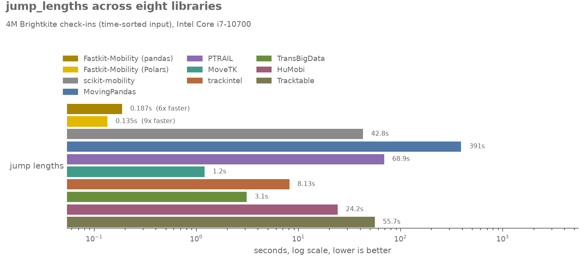

## Measures

### Individual

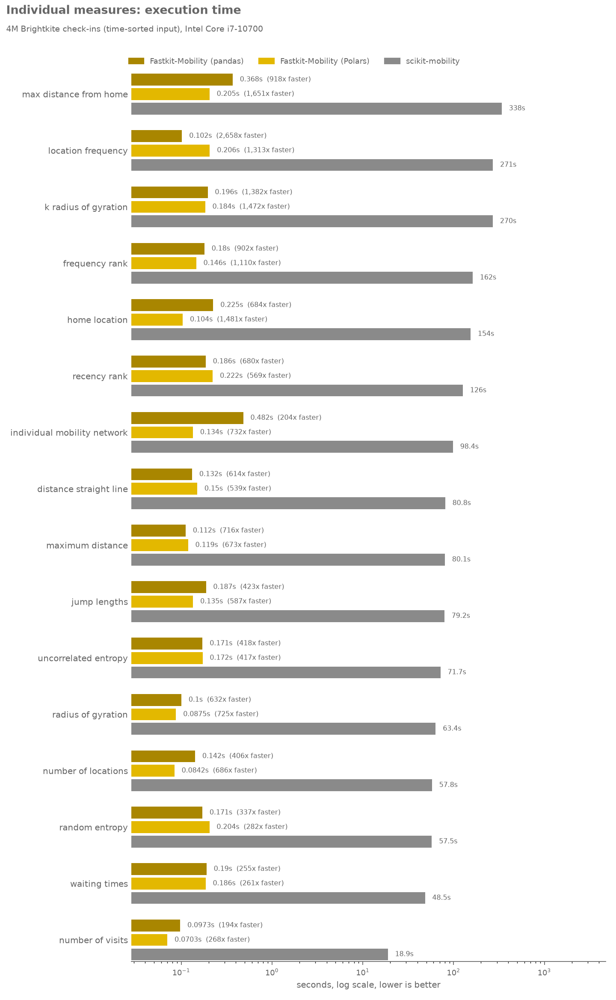

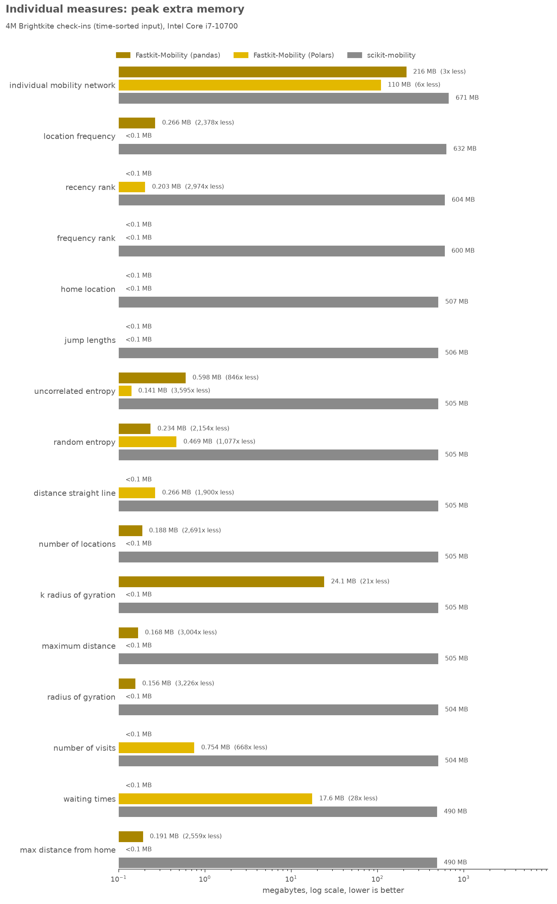

### Collective

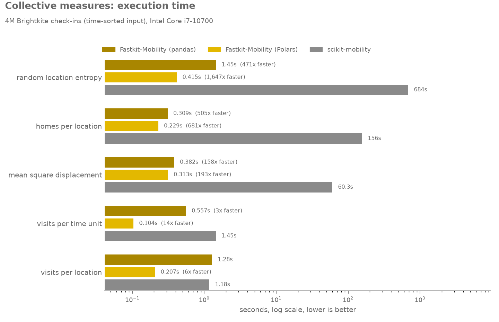

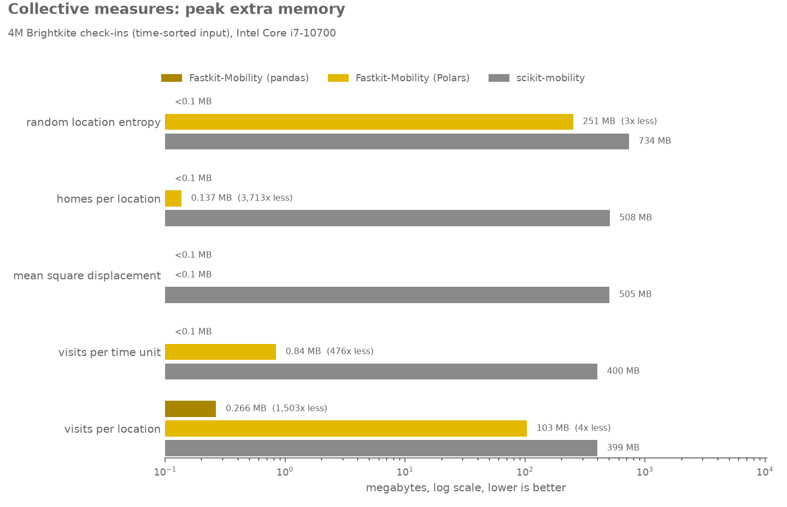

## Preprocessing

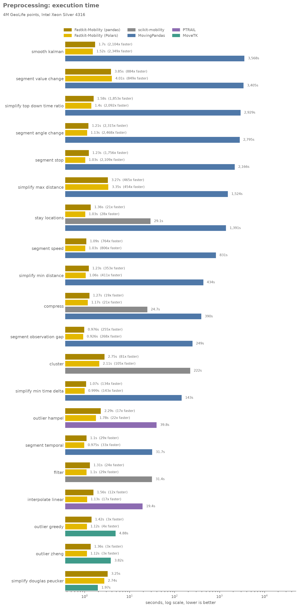

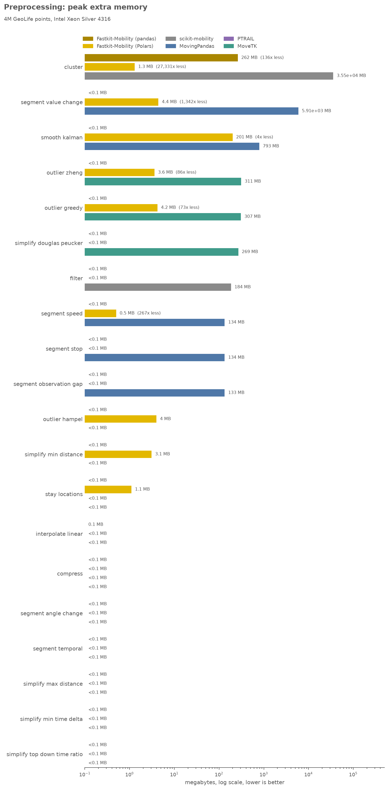

## Distributed baseline: SparkMobility

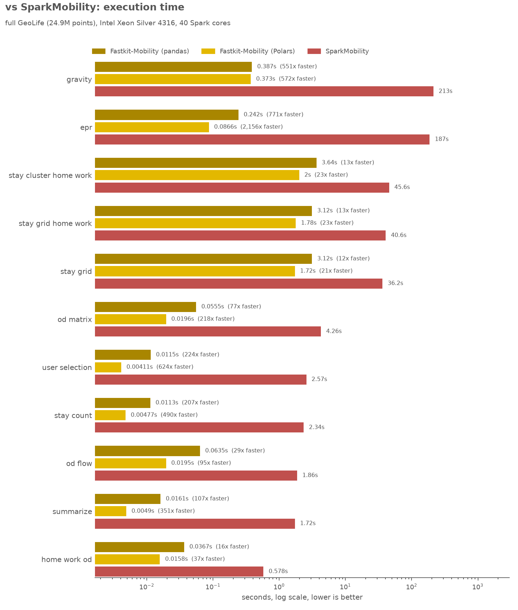

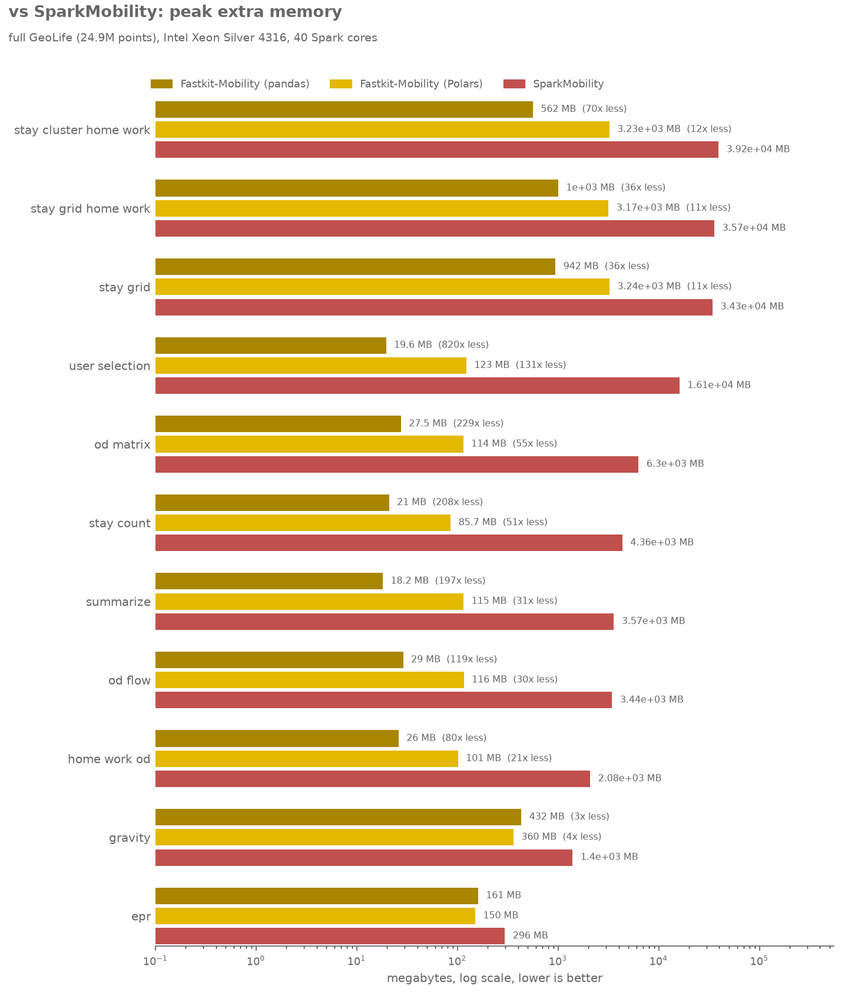

## Measures - Evaluation

*The evaluation and model plots below are earlier snapshots in the previous plotting style.*

#### Measures - Evaluation - (Speed) - NumPy and Rust kernels
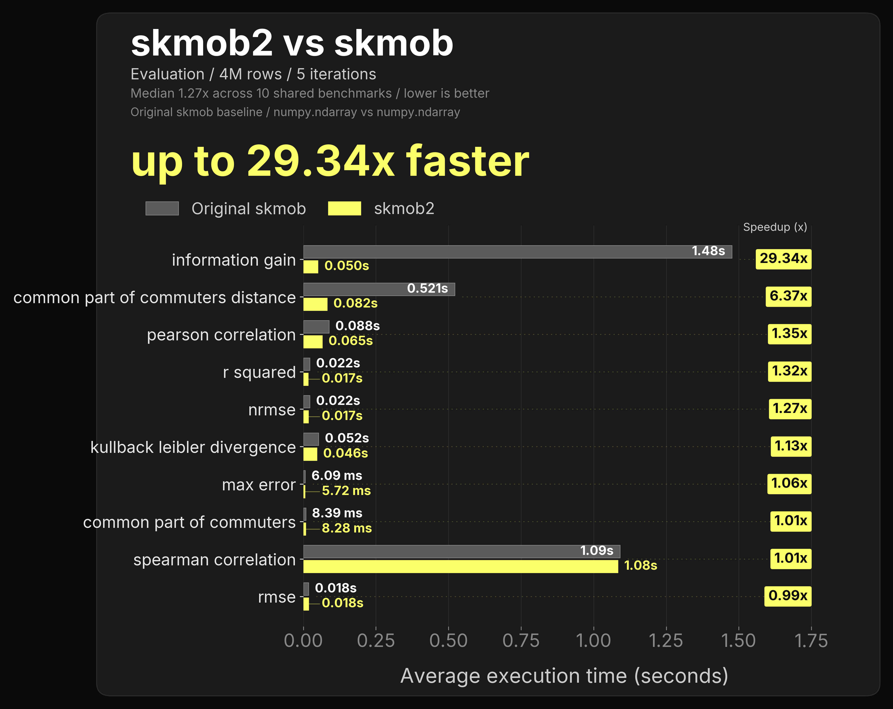
<!-- 
#### Measures - Evaluation - (Memory) (Still needs adjusts)
 -->


## Models

#### Models Agents - Speed
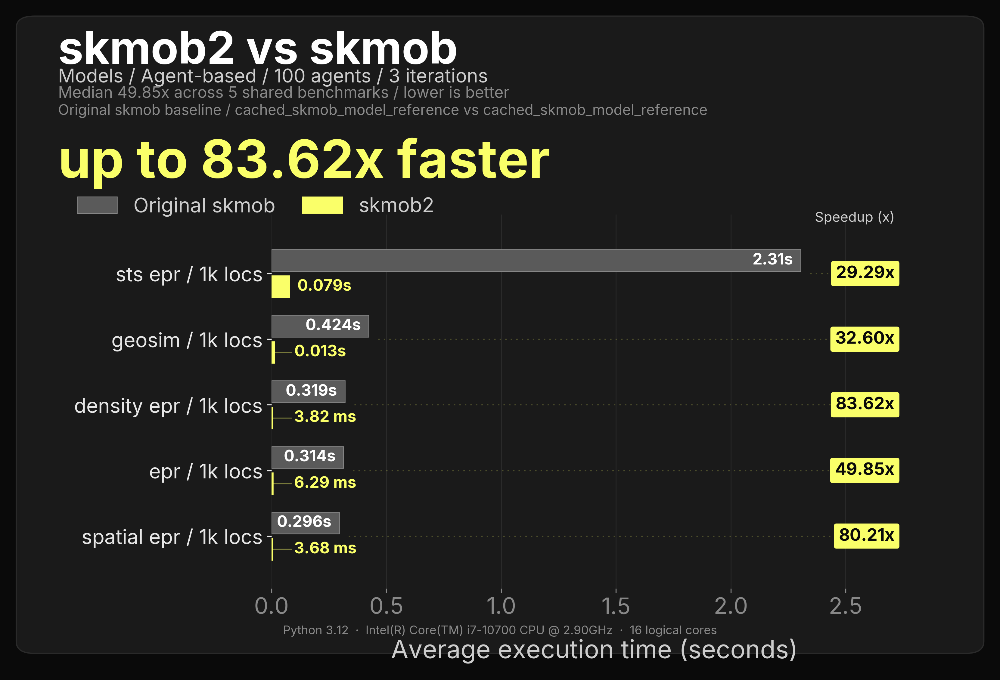


#### Models Agents - Speed (No rust core yet...)
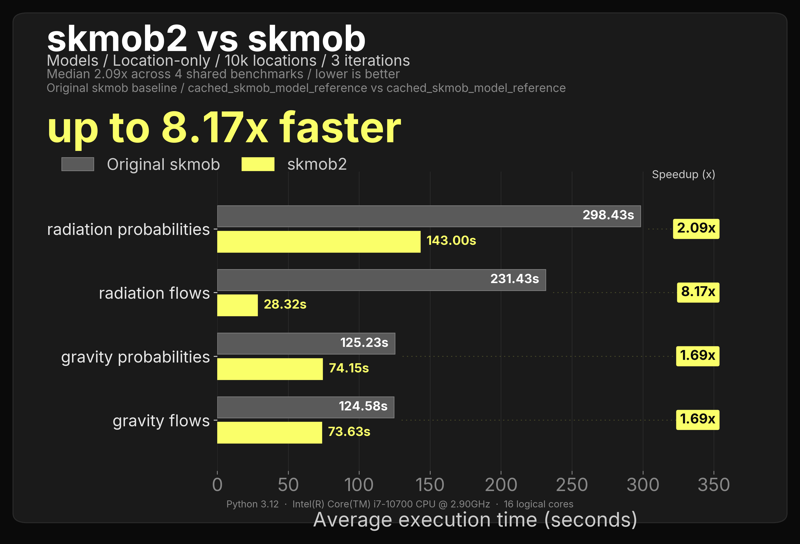


## Privacy

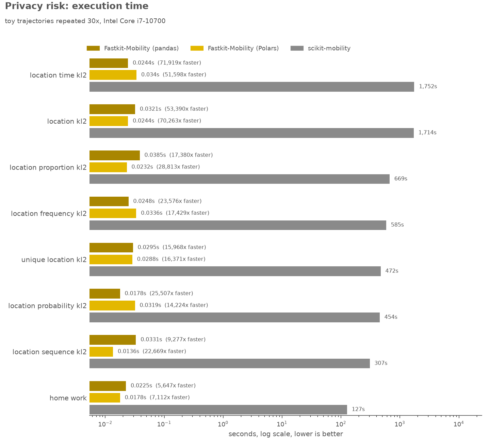

## Reproduce the figures

The figures are drawn from the raw results of the sibling `fastmob_benchmarks` repository:

```bash
uv run --no-project --with matplotlib python scripts/make_benchmark_figures.py
```

Each figure is one entry of `figures()` in that script, so a new comparison needs one new entry.
