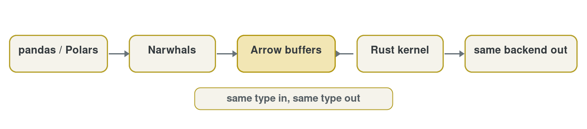

# Features

Fastkit-Mobility runs the scikit-mobility measure API on a Rust core, on whatever
dataframe you already use.

<div class="stat-strip"><span>623x median speedup on 16 measures</span></div>

<div class="feature-grid">
<a class="feature-card" href="../learn/analyze-a-simple-trajectory/">

<h3>Familiar API →</h3>
<p>Port existing code with an import change.</p>
</a>
<a class="feature-card" href="../learn/use-custom-columns-and-dataframe-backends/">

<h3>Any dataframe&nbsp;→</h3>
<p>pandas, Polars and other Narwhals backends in; the same backend out.</p>
</a>
<div class="feature-card">

<h3>Low memory</h3>
<p>Kernels read your columns in place instead of copying or sorting whole tables.</p>
</div>
<div class="feature-card">

<h3>Validated</h3>
<p>Correctness tests on pandas and Polars, plus comparison tests against scikit-mobility. Run them yourself.</p>
</div>
<div class="feature-card">

<h3>Open source</h3>
<p>BSD-3 licensed. Read the source, file issues, reproduce every benchmark.</p>
</div>
</div>

## Any dataframe in, same backend out

<div class="figure figure-scroll">

</div>

## Switching is one import

```python
# before
import skmob.measures.individual as m
# after
import fastmob as m
```

## Speed at a glance

<div class="figure">
<picture>
<source media="(max-width: 600px)" srcset="../assets/images/home/home-benchmark-speedup-mobile.png">

</picture>
</div>

Average of 5 runs on 4 million Brightkite check-ins, pandas backend. Hardware
and methodology are on the [benchmarks page](benchmarks.md).

## Dig deeper

<div class="feature-grid">
<a class="feature-card" href="benchmarks/">

<h3>Benchmarks →</h3>
<p>Numbers for every measure family, pandas and Polars.</p>
</a>
<a class="feature-card" href="optimizations/">

<h3>Optimizations →</h3>
<p>How indexed ranges and batched kernels keep memory low.</p>
</a>
</div>
