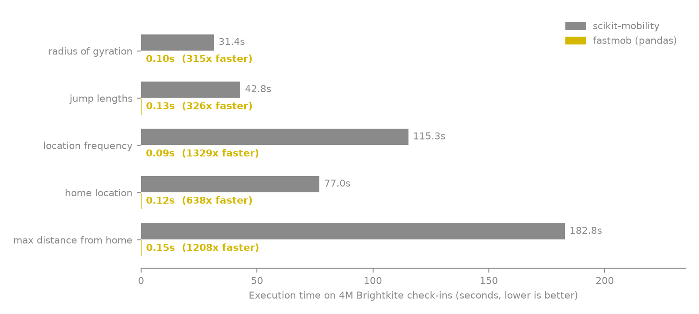
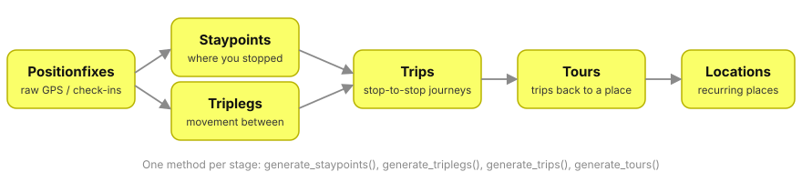

---
hide:
  - toc
---

# Mobility analysis, hundreds of times faster

<p class="hero-lead">
<strong>fastmob</strong> is a Python library for human-mobility data: clean GPS
traces, find stops and trips, and measure how individuals and populations move.
Rust kernels do the heavy lifting; you keep your pandas or Polars dataframes.
</p>

<div class="hero-actions">
<a class="hero-button hero-button--primary" href="learn/analyze-a-simple-trajectory/">Get started →</a>
<a class="hero-button" href="reference/">API reference</a>
<a class="hero-button" href="features/benchmarks/">Benchmarks</a>
</div>

```bash
pip install fastmob
```

=== "pandas"

    ```python
    import pandas as pd
    from fastmob import jump_lengths, radius_of_gyration

    df = pd.DataFrame({
        "uid": ["alice"] * 3 + ["bob"] * 3,
        "datetime": pd.to_datetime(["2020-01-01 08:00", "2020-01-01 09:00", "2020-01-01 10:00"] * 2),
        "lat": [41.9, 42.0, 42.1, 40.7, 40.8, 40.9],
        "lng": [12.5, 12.5, 12.5, -74.0, -74.0, -74.0],
    })

    jump_lengths(df)        # km between consecutive points, per user
    radius_of_gyration(df)  # how far each user ranges around their center
    ```

=== "Polars"

    ```python
    import polars as pl
    from fastmob import jump_lengths

    df = pl.DataFrame({
        "uid": ["alice"] * 3,
        "datetime": ["2020-01-01 08:00", "2020-01-01 09:00", "2020-01-01 10:00"],
        "lat": [41.9, 42.0, 42.1],
        "lng": [12.5, 12.5, 12.5],
    }).with_columns(pl.col("datetime").str.to_datetime())

    jump_lengths(df)  # returns a Polars DataFrame
    ```

```text
     uid  radius_of_gyration
0  alice             9.07904
1    bob             9.07904
```

## Fast on real data

Average execution time on 4 million Brightkite check-ins, fastmob (pandas) versus
scikit-mobility. [See all measures and methodology](features/benchmarks.md).



## From raw GPS fixes to tours

Each level of the hierarchy is derived from the one below it with a single
method call.



## What you can do

<div class="feature-grid">
<a class="feature-card" href="learn/clean-and-segment/">
<h3>Clean and segment</h3>
<p>Filter noise, compress, and split traces into movement and stops.</p>
</a>
<a class="feature-card" href="learn/staypoints-and-locations/">
<h3>Staypoints and locations</h3>
<p>Detect where people stop and cluster recurring places such as home and work.</p>
</a>
<a class="feature-card" href="learn/individual-and-collective-measures/">
<h3>Measure mobility</h3>
<p>Radius of gyration, entropy, jump lengths, flows and more, per person or per population.</p>
</a>
<a class="feature-card" href="learn/network-analysis/">
<h3>Networks and map matching</h3>
<p>Route and map-match trajectories on road and rail graphs.</p>
</a>
<a class="feature-card" href="learn/fit-and-evaluate/">
<h3>Fit and evaluate</h3>
<p>Fit mobility laws and compare generated trajectories with observed ones.</p>
</a>
<a class="feature-card" href="reference/models/">
<h3>Generate synthetic mobility</h3>
<p>Gravity, radiation, EPR and other models for flows and trajectories.</p>
</a>
</div>

## Why fastmob

- **Any dataframe.** Narwhals accepts pandas, Polars and other eager backends and returns the same type.
- **Native speed.** Parallel Rust kernels read your columns without copying.
- **Familiar API.** Measure names and signatures follow [scikit-mobility](https://github.com/scikit-mobility/scikit-mobility), so existing code ports easily.
- **Tested.** Correctness suites run on pandas and Polars, with comparison tests against scikit-mobility where the APIs overlap.

Requires Python 3.9 or later. Prebuilt wheels are available, so no Rust toolchain
is needed to install. Building from source is covered in
[development setup](about/development.md).

## Next steps

<div class="feature-grid">
<a class="feature-card" href="learn/">
<h3>Learn →</h3>
<p>Step-by-step guides with runnable examples.</p>
</a>
<a class="feature-card" href="reference/">
<h3>Reference →</h3>
<p>Every function, parameter and return schema.</p>
</a>
<a class="feature-card" href="features/benchmarks/">
<h3>Benchmarks →</h3>
<p>Methodology and results across all measure families.</p>
</a>
</div>
