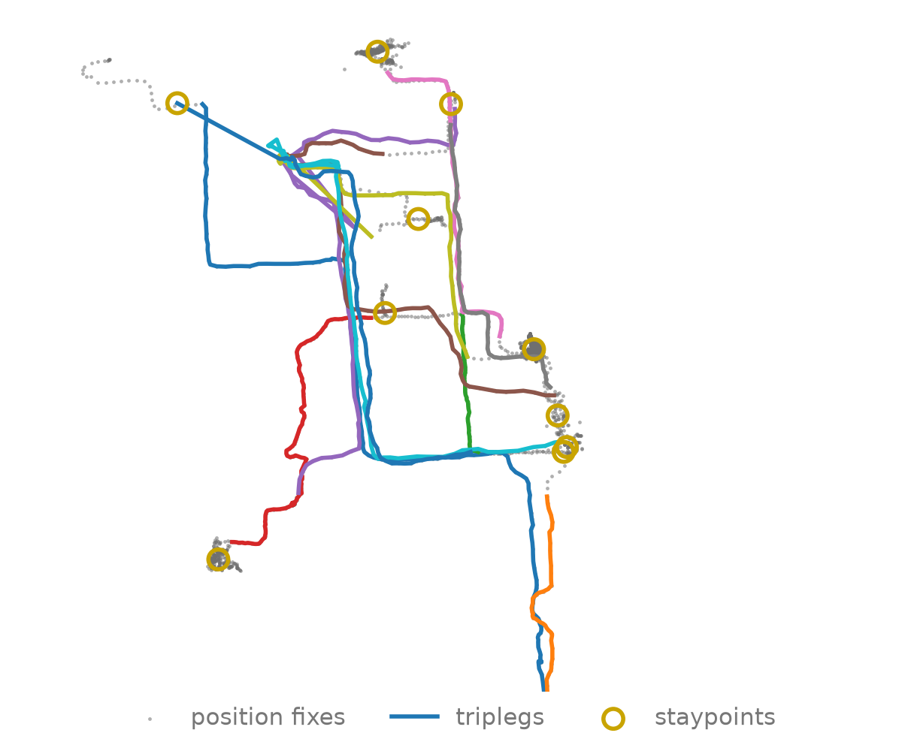

---
hide:
  - navigation
  - toc
---

# Mobility analysis, hundreds of times faster

<p class="hero-lead">
<strong>fastmob</strong> cleans GPS traces, finds stops and trips, and measures how
people move. Rust does the heavy lifting; you keep your pandas or Polars dataframes.
</p>

<div class="hero-actions">
<a class="hero-button hero-button--primary" href="learn/analyze-a-simple-trajectory/">Get started →</a>
<a class="hero-button" href="reference/">API reference</a>
<a class="hero-button hero-button--optional" href="features/benchmarks/">Benchmarks</a>
</div>

<p class="figure-caption">Average time on 4 million Brightkite check-ins, fastmob (pandas) versus scikit-mobility. <a href="features/benchmarks/">All measures and methodology</a>.</p>
<div class="figure">
<picture>
<source media="(max-width: 600px)" srcset="assets/images/home/home-benchmark-speedup-mobile.png">

</picture>
</div>


## Try it

```bash
pip install fastmob
```

=== "pandas"

    ```python
    import pandas as pd
    from fastmob import radius_of_gyration

    df = pd.DataFrame({
        "uid": ["alice"] * 3 + ["bob"] * 3,
        "datetime": pd.to_datetime(["2020-01-01 08:00", "2020-01-01 09:00", "2020-01-01 10:00"] * 2),
        "lat": [41.9, 42.0, 42.1, 40.7, 40.8, 41.0],
        "lng": [12.5, 12.5, 12.6, -74.0, -74.0, -73.9],
    })

    radius_of_gyration(df)  # km each user ranges around their center
    ```

    ```text
         uid  radius_of_gyration
    0  alice            9.878827
    1    bob           14.423721
    ```

=== "Polars"

    ```python
    import polars as pl
    from fastmob import radius_of_gyration

    df = pl.DataFrame({
        "uid": ["alice"] * 3 + ["bob"] * 3,
        "datetime": ["2020-01-01 08:00", "2020-01-01 09:00", "2020-01-01 10:00"] * 2,
        "lat": [41.9, 42.0, 42.1, 40.7, 40.8, 41.0],
        "lng": [12.5, 12.5, 12.6, -74.0, -74.0, -73.9],
    }).with_columns(pl.col("datetime").str.to_datetime())

    radius_of_gyration(df)  # returns a Polars DataFrame
    ```

    ```text
    uid      radius_of_gyration
    "alice"  9.878827
    "bob"    14.423721
    ```

## From raw GPS fixes to tours

Each level of the hierarchy is derived from the one below it with a single
method call.

<div class="figure">
<picture>
<source media="(max-width: 600px)" srcset="assets/images/home/mobility-hierarchy-vertical.svg">

</picture>
</div>

## What you can do

<div class="figure figure--square">

</div>
<p class="figure-caption">One day of a GeoLife user in Beijing: fastmob turns raw fixes into staypoints and triplegs.</p>

<div class="feature-grid">
<a class="feature-card" href="learn/clean-and-segment/">
<h3>Clean and segment</h3>
<p>Filter noise, compress, and split traces into movement and stops.</p>
</a>
<a class="feature-card" href="learn/staypoints-and-locations/">
<h3>Staypoints and locations</h3>
<p>Detect where people stop and cluster recurring places such as home and work.</p>
</a>
<a class="feature-card" href="learn/individual-and-collective-measures/">
<h3>Measure mobility</h3>
<p>Radius of gyration, entropy, jump lengths, flows and more, per person or per population.</p>
</a>
<a class="feature-card" href="learn/network-analysis/">
<h3>Networks and map matching</h3>
<p>Route and map-match trajectories on road and rail graphs.</p>
</a>
<a class="feature-card" href="learn/fit-and-evaluate/">
<h3>Fit and evaluate</h3>
<p>Fit mobility laws and compare generated trajectories with observed ones.</p>
</a>
<a class="feature-card" href="reference/models/">
<h3>Generate synthetic mobility</h3>
<p>Gravity, radiation, EPR and other models for flows and trajectories.</p>
</a>
</div>

## Why fastmob

- **Familiar API.** Measure names and signatures follow [scikit-mobility](https://github.com/scikit-mobility/scikit-mobility), so existing code ports easily, and comparison tests check the results.
- **Any dataframe, no copies.** Narwhals accepts pandas, Polars and other eager backends and returns the same type; Rust kernels read your columns in place.

Requires Python 3.9 or later. Prebuilt wheels are available, so no Rust toolchain
is needed to install; building from source is covered in
[development setup](about/development.md).

## Next steps

<div class="feature-grid">
<a class="feature-card" href="learn/use-custom-columns-and-dataframe-backends/">
<h3>Columns and backends →</h3>
<p>Use your own column names and move between pandas and Polars.</p>
</a>
<a class="feature-card" href="learn/notebooks/stay-point-detection-geolife/">
<h3>Stay-point notebook →</h3>
<p>An end-to-end example on real GeoLife GPS traces.</p>
</a>
<a class="feature-card" href="resource/">
<h3>Resources →</h3>
<p>Datasets, citation, and where to get help.</p>
</a>
</div>
