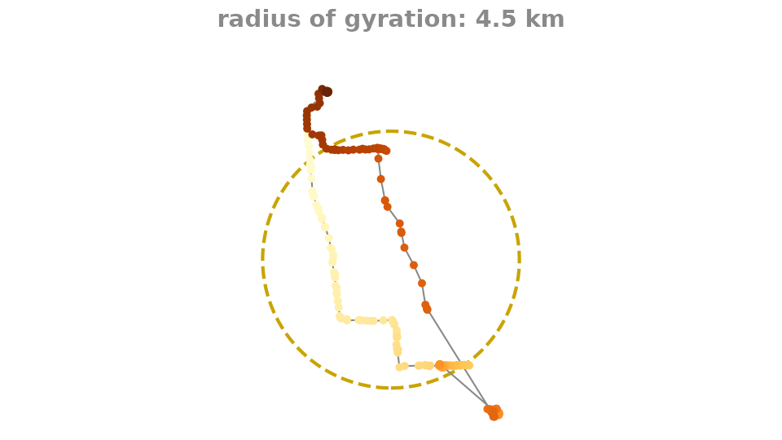
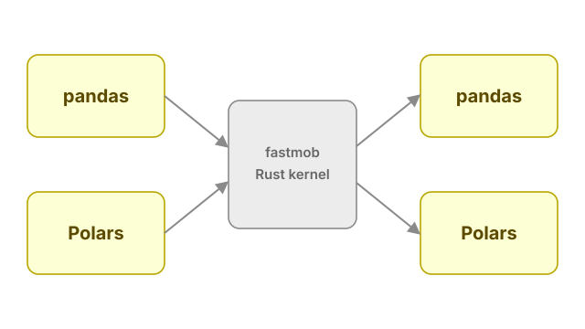
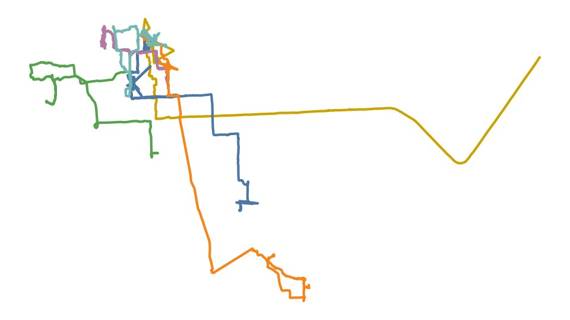
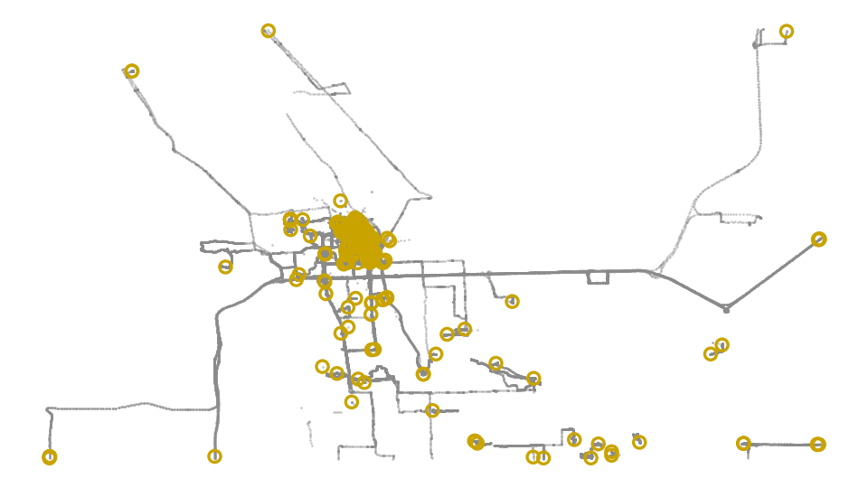
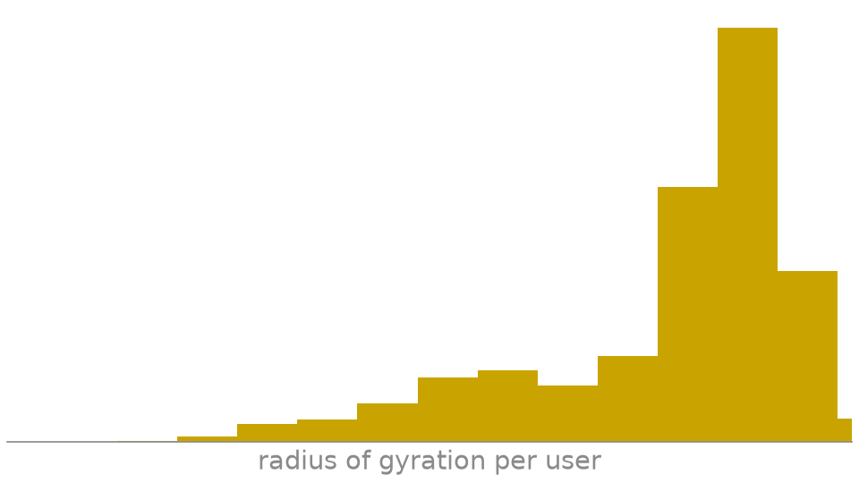
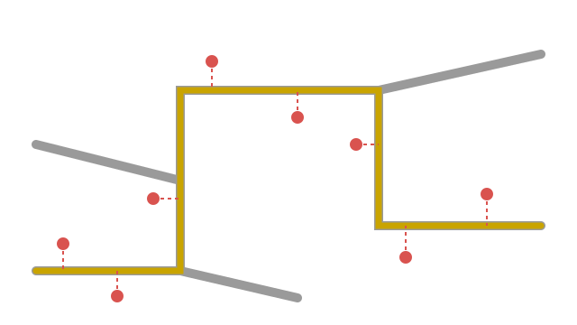
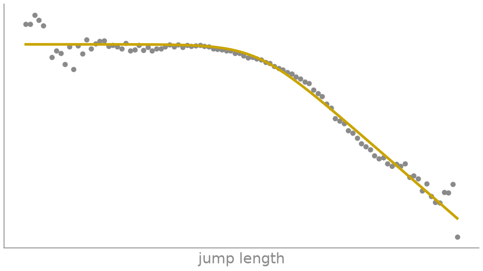
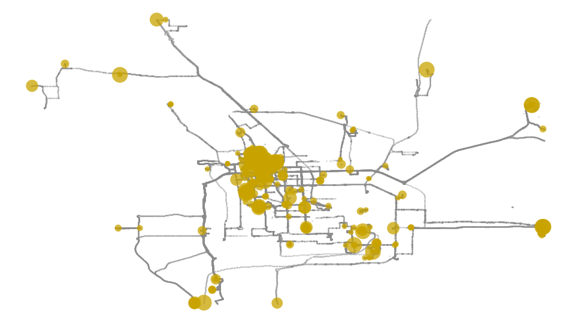
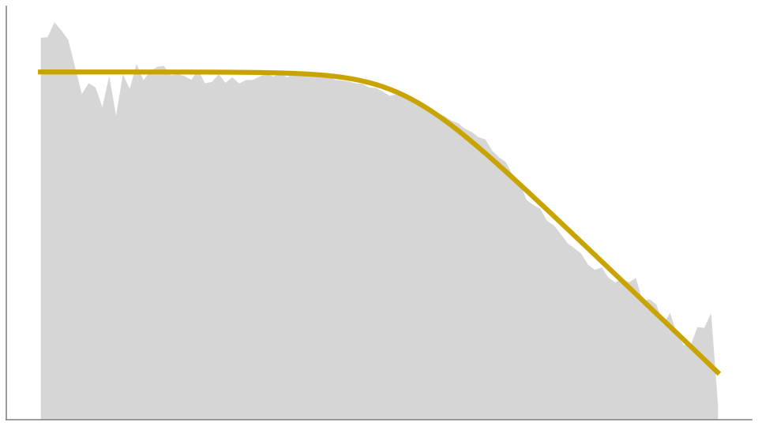

---
hide:
  - toc
---

# Learn

Short, runnable guides from a first trajectory to fitted mobility laws. New to
Fastkit-Mobility? Start with the first guide, then follow the order below. Need every
parameter? Each guide links to the [API reference](../reference/index.md).

## Guides

<a class="how-to-card how-to-card--start" href="analyze-a-simple-trajectory.md">

Start here
<h2>Start with a trajectory</h2>

Build a small trajectory and compute your first mobility measures.

Data: synthetic (figure: GeoLife)

</a>
<a class="how-to-card" href="use-custom-columns-and-dataframe-backends.md">

<h2>Columns and backends</h2>

Use your own column names, or move the same workflow between pandas and Polars.

Data: synthetic
</a>
<a class="how-to-card" href="clean-and-segment.md">

<h2>Clean and segment trajectories</h2>

Remove implausible jumps and split traces into movement episodes.

Data: GeoLife
</a>
<a class="how-to-card" href="staypoints-and-locations.md">

<h2>Create staypoints and locations</h2>

Detect where people stop and cluster repeated visits into locations.

Data: GeoLife
</a>
<a class="how-to-card" href="individual-and-collective-measures.md">

<h2>Measure people and populations</h2>

Quantify mobility per person and across a population.

Data: Brightkite
</a>
<a class="how-to-card" href="network-analysis.md">

<h2>Route and map-match trajectories</h2>

Build network-aware workflows for routes and map-matched traces.

Data: road and rail networks
</a>
<a class="how-to-card" href="fit-and-evaluate.md">

<h2>Fit and evaluate mobility results</h2>

Fit mobility laws and evaluate them against your data.

Data: Brightkite
</a>

Also see [daily mobility motifs](motifs.md), a worked example of matching daily movement patterns.

## Notebook examples

<a class="how-to-card" href="notebooks/stay-point-detection-geolife.md">

<h2>Stay-point detection notebook</h2>

An end-to-end run on GeoLife GPS traces, compared with trackintel.

Data: GeoLife · Binder notebook
</a>
<a class="how-to-card" href="compare-to-mobility-laws.md">

<h2>Compare mobility laws notebook</h2>

Fit a power law to the distribution of Brightkite jump lengths.

Data: Brightkite · Binder notebook
</a>

