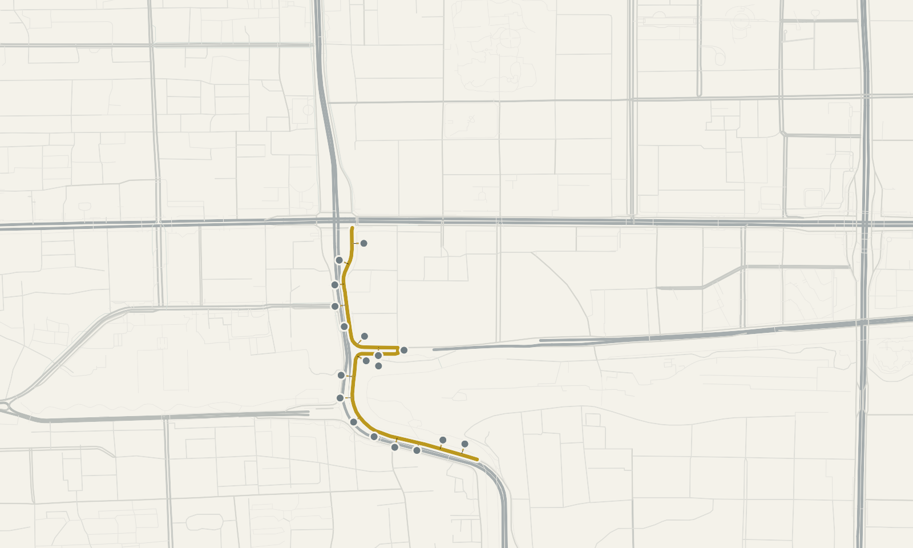

# Roads, rails and map matching

**Question.** A straight line is not how people travel. How do I measure distance along roads, find which roads a GPS trace used, and see where flows concentrate?

Use the network functions when a straight-line distance is not a useful proxy for
travel. Build the graph once, then reuse it for snapping, route queries, and
network-aware measures.

| Term | Meaning |
| --- | --- |
| Graph | Nodes (road connectors) joined by edges (road segments with a length, speed and class). |
| Snapping | Assigning a point to its nearest node, within a maximum distance. |
| Map matching | Choosing, for every GPS fix of a trace, the most likely road segment. |
| Desire line | Flow between an origin and a destination, accumulated on the roads of the fastest route. |

Road geometry from the Beijing OpenStreetMap extract; GPS observations are illustrative. © <a href="https://www.openstreetmap.org/copyright">OpenStreetMap contributors</a>.

Run it on real data in [Road networks: matching, routing and desire lines](road-network-analysis.md), which fetches a road network, matches a GPS trace, compares road and straight-line distance and accumulates flows on roads.

Build the graph once and reuse it; do not fetch or prepare it once per trajectory.
Snapping returns `-1` for a point outside the chosen threshold, and
network-aware distance measures fall back to Haversine when an endpoint is
unsnapped or disconnected.

`match_trajectory` returns one result row per input observation with matched
edge information, projected coordinates, status, and a score. It processes
users independently and splits tracks at invalid observations or large time
gaps. Its current edge projection uses connector-to-connector segments, so
inspect results carefully on curved roads.

!!! warning "Optional dependencies and data access"

    Fetching Overture networks requires the `network` extra and access to the
    requested Overture release. Save the node/edge tables with
    `build_road_graph` when repeatedly analysing the same area.

See the [network reference](../reference/network.md) for Arrow return types,
route geometry, OD desire lines, and rail support.
