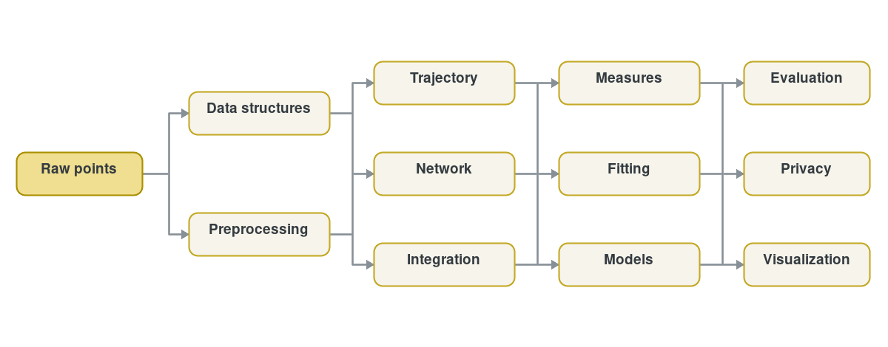

# API reference

Every public function and class in Fastkit-Mobility, grouped by module. Each module page opens with a table of its APIs (one line each, with a link to a worked example where one exists) followed by the full details: signature, parameters, return values and assumptions. To find a function by name, use the search box. To learn how to use the library, start with [Learn](../learn/index.md).

## Modules

| Module |
| --- |
| [Data structures](data-structures.md) Typed trajectory, hierarchy and flow wrappers. [`TrajDataFrame`](data-structures/traj-dataframe.md), [`Positionfixes`](data-structures/positionfixes.md) |
| [Preprocessing](preprocessing.md) Filtering, segmentation, staypoints, H3 and OD preparation. [`filter`](preprocessing.md#fastmob.preprocessing.filter), [`segment`](preprocessing.md#fastmob.preprocessing.segment), [`stay_locations`](preprocessing.md#fastmob.preprocessing.stay_locations) |
| [Trajectory](trajectory.md) Interpolation, smoothing, shape clustering and comparison. [`interpolate`](trajectory.md#fastmob.trajectory.interpolate), [`smooth`](trajectory.md#fastmob.trajectory.smooth) |
| [Tessellation](tessellation.md) Square, H3 and Voronoi tilers. [`TessellationTilers`](tessellation.md#fastmob.tessellation.tilers.TessellationTilers) |
| [Utilities](utils.md) Straight-line geographic distances. [`haversine`](utils.md#fastmob.utils.haversine) |
| [Network](network.md) Road and rail graphs, routing, snapping and map matching. [`match_trajectory`](network.md#fastmob.network.match_trajectory), [`build_road_graph`](network.md#fastmob.network.build_road_graph) |
| [Integration](integration.md) Joins with points of interest and events. [`join_with_pois`](integration.md#fastmob.integration.join_with_pois), [`join_with_events`](integration.md#fastmob.integration.join_with_events) |
| [Measures](measures/index.md) Individual, collective, contact-network and evaluation metrics. [`radius_of_gyration`](measures/individual.md#fastmob.measures.individual.radius_of_gyration), [`jump_lengths`](measures/individual.md#fastmob.measures.individual.jump_lengths) |
| [Fitting](fitting.md) Truncated power law, visitation law and daily-location fits. [`fit_values_to_truncated_powerlaw`](fitting.md#fastmob.measures.fitting.fit_values_to_truncated_powerlaw) |
| [Models](models.md) Mobility generation models. [`Gravity`](models.md#fastmob.models.gravity.Gravity), [`SpatialEPR`](models.md#fastmob.models.epr.SpatialEPR) |
| [Input/output](io.md) Readers and writers for common trajectory formats. [`read`](io.md#fastmob.io.file.read), [`load_geolife_trajectories`](io.md#fastmob.io.file.load_geolife_trajectories) |
| [Privacy](privacy.md) Re-identification risk assessment for trajectories. [`location_risk`](privacy.md#fastmob.privacy.location_risk) |
| [Data](data.md) Bundled and downloadable datasets. [`load_dataset`](data.md#fastmob.data.load_dataset), [`load_geolife`](data.md#fastmob.data.load_geolife) |
| [Visualization](visualization.md) Interactive ECharts views (`fastmob[vis]`). [`fastmob.vis`](visualization.md) |

## Start from your input

| You have | Start here |
| --- | --- |
| Raw GPS or check-in points | [Data structures](data-structures.md), then [preprocessing](preprocessing.md) |
| A cleaned trajectory | [Trajectory](trajectory.md) and [individual measures](measures/individual.md) |
| Visits, stays, or trips | [Collective measures](measures/collective.md) |
| Coordinate pairs for straight-line distance | [Haversine distance](utils.md) |
| A road/rail graph or GPS trace | [Network](network.md) |
| A model output to compare | [Evaluation](measures/evaluation.md) |
| Trajectories to assess for privacy risk | [Privacy](privacy.md) |
| A distribution to fit to a law | [Fitting](fitting.md) |
| Files on disk to read or write | [Input/output](io.md) |
| Synthetic trajectories or flows to generate | [Models](models.md) |

!!! note "Column and backend conventions"

    Most APIs auto-detect `datetime`, `lat`, `lng`, and `uid` from common
    names. Pass explicit `*_col` arguments when your schema differs. See
    [Columns and backends](../learn/use-custom-columns-and-dataframe-backends.md)
    for the supported workflow.

## How the modules fit together

